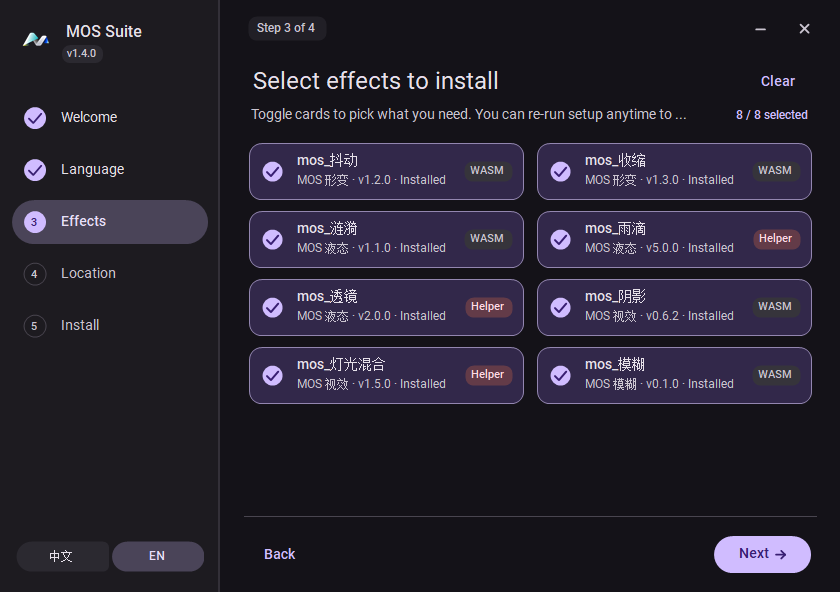
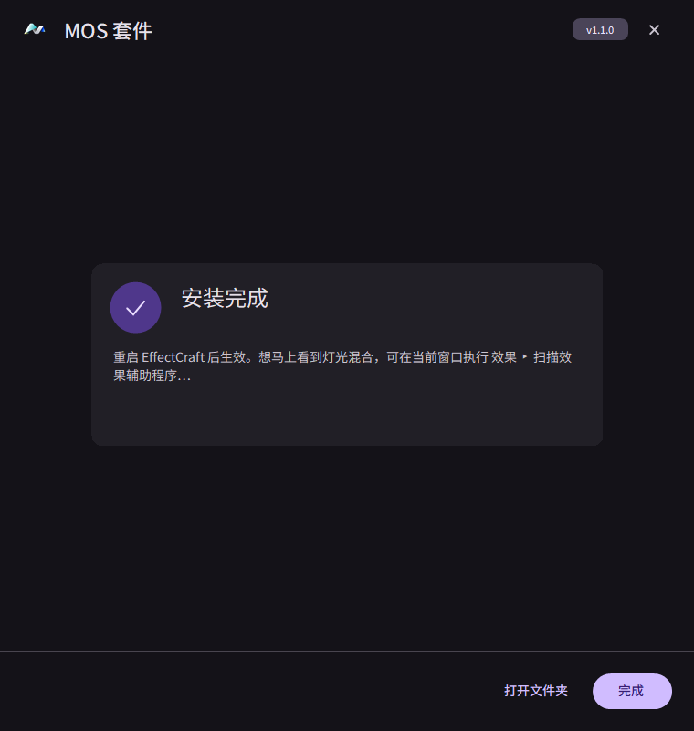

# MOS 套件 / MOS Suite

EffectCraft 的 4 个效果，合并成一个套件，并分成两个效果栏分组：

| 分组 Group | 效果 Effect | ID | 版本 Version |
| --- | --- | --- | --- |
| MOS 形变 / MOS Deform | 抖动 Shake | `mos.shake` | 1.2.0 |
| MOS 形变 / MOS Deform | 收缩 Shrink | `mos.shrink` | 1.3.7 |
| MOS 视效 / MOS VFX | 阴影 Shadow | `mos.shadow` | 0.6.2 |
| MOS 视效 / MOS VFX | 灯光混合 Light Mix | `mos.lightwrap` | 1.4.0 |

三个 wasm 插件各有中文、英文两份构建；灯光混合是外部助手，同一份 exe 按 `mos-suite.json` 的 `effectsLanguage` 显示中文或英文。

| 中文界面 | English UI |
| --- | --- |
|  |  |
|  |  |

## 目录

```
mos/
  suite/                本目录：安装器、安装说明、发布产物
    installer/          安装器源码（C# / .NET Framework 4，无 SDK 依赖）
    docs/zh, docs/en    手动安装说明（会装进 <root>\mos-suite\manual\）
    release/            构建产物：MOS-Suite-Setup-1.0.0.exe
  vfx/mos_阴影/           mos.shadow（wasm，api 2）
  vfx/mos_灯光混合/        mos.lightwrap（Rust 外部助手）
  形变/mos_shake/         mos.shake（wasm，api 1）
  形变/mos_收缩/           mos.shrink（wasm，api 1）
```

## 构建

前提：Windows、Node.js（各 wasm 插件目录里已带 `wabt` 依赖）、Rust 工具链（只有灯光混合需要）、.NET Framework 4（Windows 自带 `csc.exe`）。不需要 Visual Studio、不需要 .NET SDK。

```powershell
# 1) 三个 wasm 插件：每份中文 + 英文
node 形变\mos_shake\build.js
node 形变\mos_收缩\build.js
node vfx\mos_阴影\build.js

# 2) 灯光混合助手（Rust）
cargo build --release --manifest-path vfx\mos_灯光混合\helper\Cargo.toml
# 把 target\release\effectcraft-helper-mos-lightmix.exe 复制到 vfx\mos_灯光混合\dist\

# 3) 安装器
powershell -ExecutionPolicy Bypass -File suite\installer\build.ps1
```

产物在 `suite\release\MOS-Suite-Setup-1.0.0.exe`。安装器把 payload 以 zip 资源嵌进 exe，不需要旁置文件。

## 安装

双击安装器，或看 `docs/zh/安装说明.md` / `docs/en/Install-Guide.md` 手动安装。安装器支持静默：

```powershell
MOS-Suite-Setup-1.0.0.exe /S /lang=en /effects=en /dir="%APPDATA%\EffectCraft"
MOS-Suite-Setup-1.0.0.exe /S /uninstall
```

日志写到 `%TEMP%\mos-suite-setup.log`。

## 语言

- 安装器语言：跟随系统 / 中文 / English。
- 效果栏语言：跟随系统 / 中文 / English，写进 `%APPDATA%\EffectCraft\mos-suite.json` 的 `effectsLanguage`；三个 wasm 装对应语言版本，灯光混合助手启动时读这个值。
- 跟随系统 = `CultureInfo.CurrentUICulture` 是 `zh` 用中文，否则英文。

## 许可

AGPL-3.0-or-later（GNU Affero 通用公共许可证第 3 版或更高版本），见 `LICENSE`。把改动后的版本作为网络服务提供给他人时，需要按该许可证公开对应源码。灯光混合是 Light Wrap 类效果的独立实现（灵感来自 Digital Anarchy Light Wrap Fantastic），不含第三方代码或素材，与该产品及其公司无隶属关系；发布时不要附带 `_ref` 里的参考文档。

---

# MOS Suite (English)

Four EffectCraft effects, shipped as one suite in two Effects-panel groups (table above). The three wasm plugins are built twice (zh / en); Light Mix is a single external helper exe that localizes itself from `effectsLanguage` in `mos-suite.json`.

Build with `node <plugin>/build.js` for the wasm plugins, `cargo build --release` for the Light Mix helper, then `powershell -File suite/installer/build.ps1`. The installer embeds its payload, so the produced exe is standalone.

Install by running the installer or following `docs/en/Install-Guide.md`. Silent install: `/S /lang=en /effects=en /dir="..."`, `/S /uninstall`; log in `%TEMP%\mos-suite-setup.log`.

AGPL-3.0-or-later, see `LICENSE`. If you offer a modified version to others over a network, you must publish the corresponding source under the same license. Light Mix is an independent Light Wrap style effect inspired by Digital Anarchy Light Wrap Fantastic; it contains no third-party code or assets and is not affiliated with that company. Do not publish the reference documents in `_ref`.
