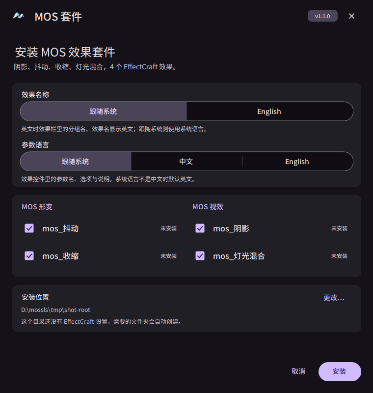
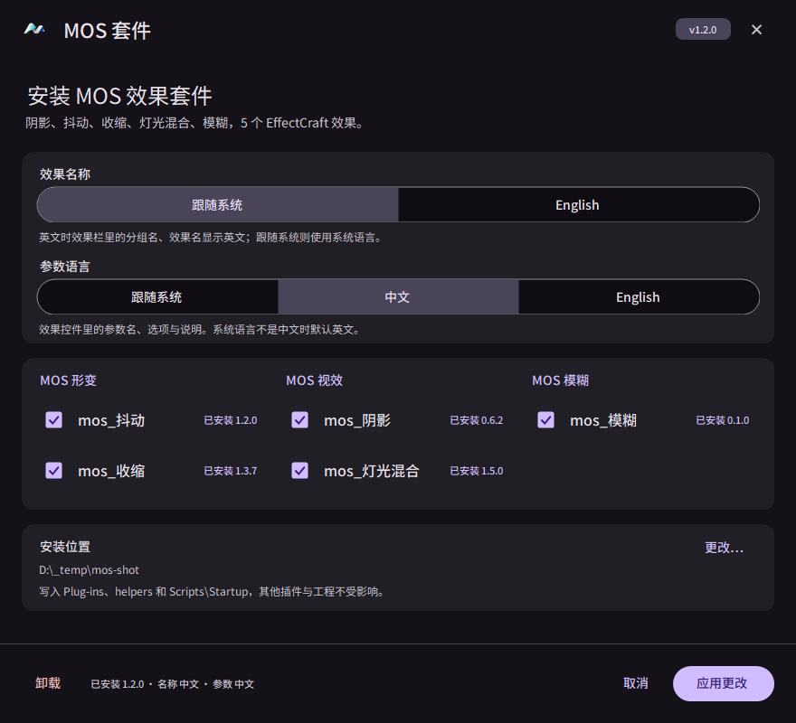

# MOS 套件 / MOS Suite

EffectCraft 的 4 个效果，合并成一个套件，并分成两个效果栏分组：

| 分组 Group | 效果 Effect | ID | 版本 Version | 源码 Source |
| --- | --- | --- | --- | --- |
| MOS 形变 / MOS Deform | 抖动 Shake | `mos.shake` | 1.2.0 | <https://github.com/mossls-studio/mos-shake> |
| MOS 形变 / MOS Deform | 收缩 Shrink | `mos.shrink` | 1.3.7 | <https://github.com/mossls-studio/mos-shrink> |
| MOS 视效 / MOS VFX | 阴影 Shadow | `mos.shadow` | 0.6.2 | <https://github.com/mossls-studio/mos-shadow> |
| MOS 视效 / MOS VFX | 灯光混合 Light Mix | `mos.lightwrap` | 1.5.0 | <https://github.com/mossls-studio/mos-lightmix> |

开源地址（AGPL-3.0-or-later，各自独立仓库，安装器与说明在套件仓库）：

| 仓库 Repository | 内容 Contents |
| --- | --- |
| <https://github.com/mossls-studio/mos-suite> | 套件：Material 3 安装器源码、双语安装说明、发布产物 |
| <https://github.com/mossls-studio/mos-shadow> | 阴影 `mos.shadow`（wasm，api 2，含源码 `src/mos_shadow.wat` 与构建脚本） |
| <https://github.com/mossls-studio/mos-shake> | 抖动 `mos.shake`（wasm，api 1） |
| <https://github.com/mossls-studio/mos-shrink> | 收缩 `mos.shrink`（wasm，api 1） |
| <https://github.com/mossls-studio/mos-lightmix> | 灯光混合 `mos.lightwrap`（Rust 外部助手，含 `helper/src/*.rs`） |

三个 wasm 插件各有 4 份构建（名称语言 × 参数语言：`zh-zh`、`zh-en`、`en-zh`、`en-en`）；灯光混合是外部助手，同一份 exe 按 `mos-suite.json` 里的设置分别决定分组/效果名和参数名的语言。

| 中文界面 | English names |
| --- | --- |
|  |  |
|  |  |

## 目录

```
mos/
  suite/                本目录：安装器、安装说明、发布产物
    installer/          安装器源码（C# / .NET Framework 4，无 SDK 依赖）
      assets/           顶栏 logo（png + ico）
    docs/zh, docs/en    手动安装说明（会装进 <root>\mos-suite\manual\）
    release/            构建产物：MOS-Suite-Setup-1.1.0.exe
  vfx/mos_阴影/           mos.shadow（wasm，api 2）
  vfx/mos_灯光混合/        mos.lightwrap（Rust 外部助手）
  形变/mos_shake/         mos.shake（wasm，api 1）
  形变/mos_收缩/           mos.shrink（wasm，api 1）
```

## 构建

前提：Windows、Node.js（各 wasm 插件目录里已带 `wabt` 依赖）、Rust 工具链（只有灯光混合需要）、.NET Framework 4（Windows 自带 `csc.exe`）。不需要 Visual Studio、不需要 .NET SDK。

```powershell
# 1) 三个 wasm 插件：默认各出 4 种语言组合到 dist\<名称语言>-<参数语言>\
node 形变\mos_shake\build.js
node 形变\mos_收缩\build.js
node vfx\mos_阴影\build.js

# 2) 灯光混合助手（Rust）
cargo build --release --manifest-path vfx\mos_灯光混合\helper\Cargo.toml
# 把 target\release\effectcraft-helper-mos-lightmix.exe 复制到 vfx\mos_灯光混合\dist\

# 3) 安装器
powershell -ExecutionPolicy Bypass -File suite\installer\build.ps1
```

产物在 `suite\release\MOS-Suite-Setup-1.1.0.exe`。安装器把 payload 以 zip 资源嵌进 exe，不需要旁置文件。

## 安装

双击安装器，或看 `docs/zh/安装说明.md` / `docs/en/Install-Guide.md` 手动安装。安装器界面跟随系统语言，只提供两组设置：效果名称的语言（跟随系统 / English）和参数语言（跟随系统 / 中文 / English）。

静默安装参数：

```powershell
MOS-Suite-Setup-1.1.0.exe /S /names=en /params=zh /dir="%APPDATA%\EffectCraft"
MOS-Suite-Setup-1.1.0.exe /S /uninstall
```

- `/names=` `system` | `en`，`/params=` `system` | `zh` | `en`；旧参数 `/lang=`、`/effects=` 仍可用（同时设置两项）。
- 日志写到 `%TEMP%\mos-suite-setup.log`。

## 语言

- 安装器界面：永远跟随系统（`CultureInfo.CurrentUICulture`），不提供选择。
- 效果名称：分组名、效果名、描述用 `namesLanguage`（`system` / `en`）；跟随系统时非中文系统按英文。
- 参数语言：参数名和下拉选项用 `paramsLanguage`（`system` / `zh` / `en`）；跟随系统且套件没有对应语言时按英文。
- 安装器把两项设置写进 `%APPDATA%\EffectCraft\mos-suite.json`（`schema: 2`）的 `namesLanguage` / `paramsLanguage`，并把最终生效的 `namesResolved` / `paramsResolved` 一起写进去——wasm 按组合挑选，灯光混合助手读这两个 resolved 值。
- 旧版的单键 `effectsLanguage` 仍能识别。

## 许可

AGPL-3.0-or-later（GNU Affero 通用公共许可证第 3 版或更高版本），见 `LICENSE`。把改动后的版本作为网络服务提供给他人时，需要按该许可证公开对应源码。灯光混合是 Light Wrap 类效果的独立实现，不含第三方代码或素材；发布时不要附带 `_ref` 里的参考文档。

---

# MOS Suite (English)

Four EffectCraft effects, shipped as one suite in two Effects-panel groups (table above). Each effect has its own AGPL-3.0-or-later repository: [mos-shake](https://github.com/mossls-studio/mos-shake), [mos-shrink](https://github.com/mossls-studio/mos-shrink), [mos-shadow](https://github.com/mossls-studio/mos-shadow), [mos-lightmix](https://github.com/mossls-studio/mos-lightmix); the installer and guides live in [mos-suite](https://github.com/mossls-studio/mos-suite). The three wasm plugins are built in four name×parameter combinations (`zh-zh`, `zh-en`, `en-zh`, `en-en`); Light Mix is a single external helper exe that localizes its names and parameter labels from the two settings in `mos-suite.json`.

Build with `node <plugin>/build.js` for the wasm plugins, `cargo build --release` for the Light Mix helper, then `powershell -File suite/installer/build.ps1`. The installer embeds its payload, so the produced exe is standalone.

Install by running the installer or following `docs/en/Install-Guide.md`. The installer UI always follows the system language and only asks two things: the language of effect names (System / English) and the parameter language (System / 中文 / English).

Silent install: `/S /names=en /params=zh /dir="..."`, `/S /uninstall`; `/names=` is `system` | `en`, `/params=` is `system` | `zh` | `en`, and the legacy `/lang=` / `/effects=` still set both. Log in `%TEMP%\mos-suite-setup.log`.

The installer writes `namesLanguage` / `paramsLanguage` plus the resolved `namesResolved` / `paramsResolved` into `%APPDATA%\EffectCraft\mos-suite.json` (`schema: 2`); the wasm is chosen by the pair and the helper localizes itself from the resolved values.

AGPL-3.0-or-later, see `LICENSE`. If you offer a modified version to others over a network, you must publish the corresponding source under the same license. Light Mix is an independent Light Wrap style effect and contains no third-party code or assets. Do not publish the reference documents in `_ref`.
